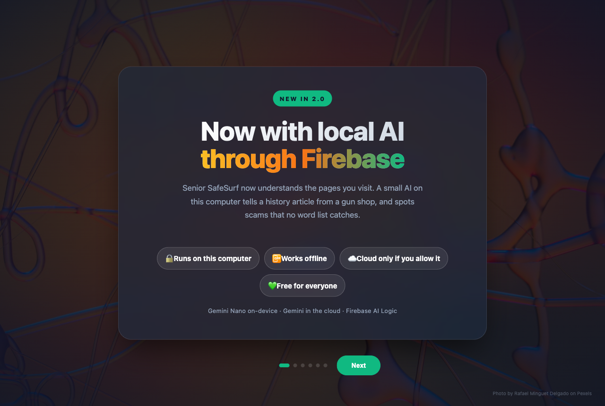
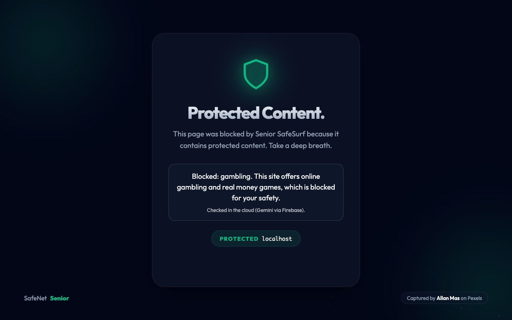
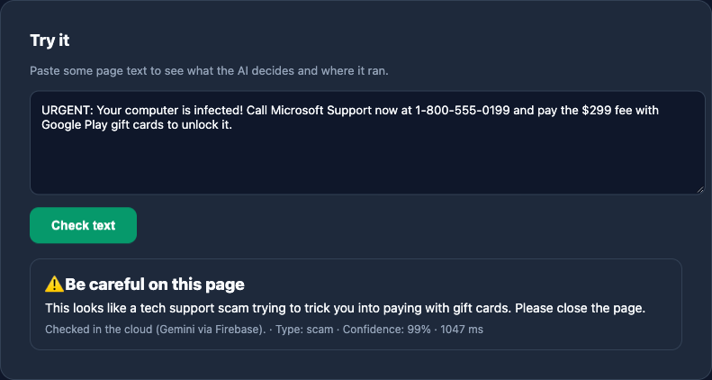
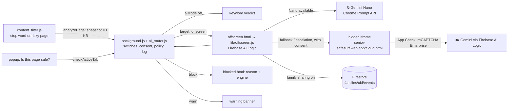

# Senior SafeSurf

A free Chrome extension that keeps older adults safe online. It blocks sites and keywords, warns about scams,
and adds a large-button speed dial and a reading-assist toolbar. Version 2 adds a **hybrid AI check built on
Firebase AI Logic**: Gemini Nano runs on the computer first, and Gemini in the cloud is used only when the
on-device model is missing or unsure, and only if the user allowed it.

Every feature is free. There is no paid tier, no license server and no backend of our own.

## Screenshots

| | |
|---|---|
|  |  |
| **First run.** The new opening slide. | **Blocked page.** The AI explains why ("Blocked: gambling…") and where it checked. |
|  |  |
| **Scam warning.** A fake bank login page with no blocked word still gets a warning. | **Popup.** One click: "Is this page safe?" |
|  |  |
| **AI Protection** (top of Settings › Instructions): mode, on-device status, cloud consent, fine-tuning, Try it. | **Family.** This week's blocks and warnings, with a plain-language AI summary. |
|  |  |
| **Setup slide.** Checks the computer, starts the Gemini Nano download, asks for cloud consent. | **Try it.** Any text, with verdict, type, confidence, engine and time. |

These were captured from the real extension with real AI answers, in a test browser that has no Gemini Nano.
That's why the status reads "cannot run on-device AI" and the results say "Checked in the cloud". It also shows
the fallback working. On a computer with Gemini Nano, the same views show "Ready on this computer" and
"🔒 Checked on this computer".

## Why AI, and why on-device first

Keyword lists fail older users in both directions:

- **Too strict.** A blocked word like "gun" also blocks a museum page about frontier history, and "tor"
  matched "history" in v1.3. Users learn to turn protection off.
- **Too weak.** Scams rarely use the exact words on a list. A fake "account suspended" login page or a fake
  tech-support alert slips through.

The AI reads the page around a blocked word and decides whether the mention is harmful, and it checks login and
payment pages for phishing signs. Page text is personal (health, banking, family), so the AI runs **on the
computer with Gemini Nano** whenever possible: private, offline, and free. The cloud model is a fallback, not
the default path.

## What the AI does

| Where | What happens | Engine |
|---|---|---|
| A stop word appears on a page | The page is covered ("checking…") and the AI judges the word in context: **block**, **warn** or **allow** | Nano first, cloud fallback |
| A page asks for a password or card number, or posts a form to another site | One background check; a confident scam/phishing verdict shows a large warning banner (never a hard block) | Nano first, cloud fallback |
| Popup: **🛡 Is this page safe?** | Plain-language answer for the open tab | Nano first, cloud fallback |
| Blocked page | Shows the AI's reason ("Blocked: gambling. …") and where it was checked | – |
| Family: **Write summary** | Weekly plain-language summary of blocks and warnings | Nano first, cloud fallback |

Every result says where it ran: 🔒 *Checked on this computer (Gemini Nano)* or ☁️ *Checked in the cloud*.

## The switches

**Settings › Instructions › AI Protection**

| Setting | Values | Default |
|---|---|---|
| Where the AI runs (`aiMode`) | Off (keywords only) · On this computer only · Hybrid · Cloud only | Hybrid |
| Allow cloud checks (`aiCloudConsent`) | on / off | asked on the welcome screen |
| Sensitivity (`aiSensitivity`) | Relaxed · Balanced · Strict | Balanced |
| Scam check on login and payment pages (`aiScanScope`) | on / off | on |
| Use Firebase Remote Config (`aiUseRemoteConfig`) | on / off | off |

The popup has a compact copy of the mode switch.

Routing rules (`src/engine.js › planRoute`):

- **Off**: keywords only, exactly like v1.3.
- **On this computer only**: Gemini Nano. If it isn't available, keywords. Never the cloud.
- **Hybrid**: Gemini Nano with `InferenceMode.PREFER_ON_DEVICE`. If Nano's confidence is below the escalation
  threshold (0.6), the same snapshot is re-checked once in the cloud. If Nano isn't available, cloud only.
  Cloud steps need consent.
- **Cloud only**: `InferenceMode.ONLY_IN_CLOUD`, needs consent.

Fail-safe rules (`ai_router.js › applyPolicy`):

- A keyword hit stays blocked unless the AI says "allow" with enough confidence (0.6 / 0.75 / 0.9 for
  Relaxed / Balanced / Strict). AI errors and timeouts keep the keyword block.
- A page without a keyword hit is only ever **warned** about, and only when the AI is confident.

### First use of the on-device model

Chrome downloads Gemini Nano (about 4 GB, once) the first time it's needed, and only after a user click:

- The welcome screen checks the computer. If the model is downloadable, pressing **Start protecting** starts
  the download and shows progress. Protection is on immediately; keywords and (if allowed) the cloud cover the
  wait.
- If the download isn't possible, the welcome screen and **AI Protection** say exactly why: Chrome older than
  138, or hardware below Chrome's requirements (Windows 10/11, macOS 13+, Linux or Chromebook Plus; 22 GB free
  disk; GPU with more than 4 GB VRAM or 16 GB RAM).
- **Settings › Instructions › AI Protection › Download on-device AI** and the popup's **Is this page safe?** button also start the
  download if it hasn't happened yet.

## What leaves the computer

Only for cloud checks, and only after consent, the extension sends a **snapshot** built by `js/snapshot.js`
(at most 3,000 characters):

- site name and path (no query string, no fragment), page title, meta description, up to 5 headings
- about 600 characters around the matched word (or the first 1,500 characters for a manual check)
- three flags: has a password field, has a card field, which other sites its forms post to

Never sent: passwords, form contents, cookies, the full address, the full page. Page text is treated as
untrusted: the prompt says so, the output must match a JSON schema, and the result is shown with
`textContent` only.

With **Family sharing** on, each block or warning is also written to Firestore: time, site name, verdict, type,
engine and the one-sentence reason. Never page text.

## Firebase products used

| Product | Used for | Code |
|---|---|---|
| **Firebase AI Logic** (hybrid inference) | Gemini Nano on-device + Gemini cloud fallback, structured JSON verdicts | `src/engine.js` |
| **App Check** (reCAPTCHA Enterprise) | Required by AI Logic; cloud calls are attested on the hosted bridge page | `src/cloud-bridge.js` |
| **Hosting** | Serves the cloud bridge (`senior-safesurf.web.app`) | `web/`, `firebase.json` |
| **Remote Config** | Optional AI tuning (cloud kill switch, cloud model, escalation threshold, extra prompt guidance), and the Pexels API key for background photos, so no key is in the code | `src/engine.js`, `src/pexels.js`, `remoteconfig.template.json` |
| **Authentication** (email/password) | Optional family account | `src/family.js` |
| **Cloud Firestore** | Optional shared family log, owner-only and append-only rules | `src/offscreen.js`, `src/family.js`, `firestore.rules` |

## Architecture



- Content scripts are classic scripts and can't load the Firebase SDK, so they only build the snapshot.
- The service worker applies the switches and the fail-safe policy and keeps a local, capped block log
  (200 entries, no page text).
- The SDK runs in an **offscreen document** (`DOM_PARSER` reason), bundled with esbuild because Manifest V3
  forbids remote code. Auth uses `firebase/auth/web-extension`, which never loads remote scripts.

## Family sharing (Firestore)

Optional, off by default. It lets a son or daughter see what was blocked on a parent's computer.

1. In **Settings › Family**, create one family account (email + password) on the parent's computer. Sharing
   turns on.
2. Install Senior SafeSurf on the family member's Chrome, open **Settings › Family** and sign in with the same
   account.
3. Both computers now show the shared log for the last 7 days. **Write summary** produces a short weekly
   summary, on-device when possible.

Data model: `families/{uid}/events/{autoId}` = `{ ts, host, verdict, category, engine, reason, createdAt }`.
`firestore.rules` allows only the signed-in owner to read, validates every field on create, and forbids updates
and deletes, so a log entry can't be edited later.

## Setup

Requirements: Node 20+, desktop Chrome 138+.

```bash
npm install
npm run build        # bundles the Firebase SDK into lib/ (extension) and web-dist/ (cloud bridge)
npm test             # unit tests (keywords, routing, policy, verdict parsing)
```

Load it: `chrome://extensions` → Developer mode → **Load unpacked** → this folder.

### App Check and the cloud bridge

Firebase AI Logic enforces App Check on every cloud call, and reCAPTCHA can't run on a `chrome-extension://`
origin. So the extension sends cloud requests through a small hosted page, **`https://senior-safesurf.web.app/cloud.html`**
(`src/cloud-bridge.js`), which the AI engine loads in a hidden iframe:

- The page runs Firebase AI Logic with **App Check backed by reCAPTCHA Enterprise**, so cloud calls are attested
  like any Firebase web app. **No debug token or secret is in the extension or in this repository**, and cloud
  checks work for every install, from the Chrome Web Store or from GitHub.
- It only answers `postMessage` requests from Senior SafeSurf's two extension IDs (store build and the unpacked
  build, pinned by the `key` in `manifest.json`), and its `frame-ancestors` header lets only those IDs embed it.
- It only accepts the two request types the extension uses (verdict JSON or summary text), with a size limit.
- On-device checks never touch the bridge: Gemini Nano runs inside the extension.

The bridge is deployed to its own Hosting site: `firebase deploy --only hosting:senior-safesurf`.

Developer option: put `CLOUD_VIA=direct` and a registered `APPCHECK_DEBUG_TOKEN` in `.env.local` to call the
cloud straight from the extension with the App Check debug provider. Never publish such a build.

### Firebase project

The extension uses the `hackathon-e2f2b` project (`.firebaserc`). To use your own, change `firebaseConfig` in
`src/firebase.js` and enable Firebase AI Logic (Gemini Developer API) and App Check.

For Family sharing:

1. Firebase console › **Firestore Database** › Create database (production mode).
2. Firebase console › **Authentication** › Get started › enable **Email/Password**.
3. Put `PEXELS_API_KEY=...` in `.env.local` (gitignored).
4. `npm run deploy:firebase` deploys `firestore.rules`, the bridge page and Remote Config. The Remote Config
   template in the repo has an empty `pexels_api_key`; `scripts/remote-config.mjs` fills it from `.env.local`
   at deploy time, so the key is never committed.

## What changed in v2 (built during #BuildHybridAI)

v1.3 (the published store version, packaged February 2026) is the first commit in this repository, so the diff
shows everything built for the hackathon. It was a keyword and site blocker with a paid PRO tier, and it had
**no AI of any kind**: stop words were matched with plain `text.includes(word)`. All AI in this repository was
added in v2. v2:

- **Hybrid AI** with Firebase AI Logic: on-device Gemini Nano, cloud Gemini fallback and low-confidence
  escalation, structured verdicts, four-way switch and explicit cloud consent.
- **AI in the right places**: keyword-hit verification, scam/phishing warnings on login and payment pages, the
  "Is this page safe?" popup check, AI reasons on the blocked page, weekly family summary.
- **First-use model download** on the welcome screen with progress, and a clear explanation when the computer
  can't run it.
- **Remote Config** (optional) for the cloud kill switch, model, threshold and prompt guidance.
- **Family sharing** with Firebase Auth and Firestore, owner-only append-only rules.
- **Free for everyone**: PRO tier, Stripe checkout, license checks, the PHP server and the `alarms` permission
  removed. The Pexels key that v1.3 hardcoded now comes from Remote Config at runtime. Support opens the user's mail app instead of posting to a server.
- **Fixes**: word-boundary keyword matching (Unicode, CJK aware) instead of `includes()`, debounced page
  re-scans, single-page-app navigation handling, master password stored as PBKDF2-SHA256 (plain-text passwords
  are upgraded on first unlock), AI text rendered with `textContent` only.

## Known limitations

- Gemini Nano needs desktop Chrome on capable hardware; phones and weaker computers use the cloud (with
  consent) or keywords.
- The on-device model is configured for English input and output. Pages in other languages still work, but the
  reason sentence is in English.
- Site blocks (declarativeNetRequest rules) happen before a page loads, so they aren't reviewed by the AI.

## License

Apache-2.0. See [LICENSE](LICENSE).
